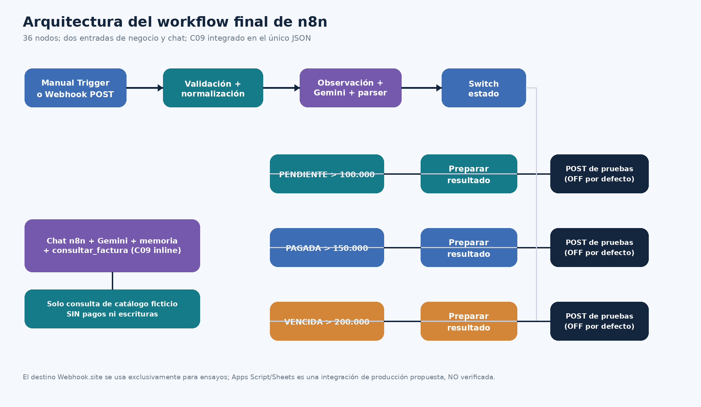

# Sistema de clasificación automática de facturas con n8n e IA

**Corte final | Automatización inteligente de procesos con n8n | EAM 2026-II**  
**Fecha de corte documental:** 16 de noviembre de 2026  
**Equipo:** Sara Reyes, Juan Esteban Giraldo, Roberto Carlos Medina, Camilo Andrés Marín, Dilan Andrés Buelvas

> **Estado verificable:** prototipo académico funcional con datos ficticios. Se comprobaron la clasificación con Gemini, el agente de consulta C09 integrado, los filtros, las respuestas del webhook (HTTP 200 y 400) y el envío de tres solicitudes POST a un receptor controlado. **No es un sistema de cobros en producción.**

## 1. Problema y propósito

La revisión manual de facturas obliga a consultar montos, estados y observaciones, priorizar casos y preparar mensajes de seguimiento. El proyecto automatiza la clasificación de estados (`pendiente`, `pagado`, `vencida`), analiza observaciones mediante Google Gemini, decide la ruta según umbrales de monto y prepara/envía registros de prueba vía HTTP. Un agente adicional contesta consultas **solo de lectura** contra un catálogo ficticio integrado.

## 2. Entregables y navegación

- [Workflow final - único JSON](workflows/Workflow_Final.json)
- [Documentación técnica y decisiones](documentacion/Documentacion_Proyecto_Final.md)
- [Presentación del proyecto - PDF](presentacion/Presentacion_Proyecto_Final.pdf)
- [Bitácora clase 11 y pruebas](pruebas/Bitacora_Clase_11_Pruebas.md)
- [Diagrama del proceso manual](documentacion/diagramas/Proceso_Manual.png) y [diagrama del proceso automatizado](documentacion/diagramas/Proceso_Automatizado.png)
- [Evidencias seleccionadas](pruebas/evidencias/)



## 3. Resumen de arquitectura

**Entrada A - Manual:** `Manual Trigger (pruebas)` produce cuatro facturas sintéticas `FAC-001` a `FAC-004`.  
**Entrada B - API:** `Webhook - Factura` recibe un JSON con `POST` y `Header Auth`, valida campos, devuelve HTTP 400 si son inválidos y normaliza los válidos.  
**Procesamiento común:** se genera ticket, se evalúa la observación con Gemini y parser estructurado (o se omite IA si está vacía), después un Switch clasifica el estado y aplica umbrales.  
**Salidas:** prepara asunto, cuerpo y resultado; tres nodos HTTP `POST` **desactivados por defecto**, conectados en el JSON a una URL de **Webhook.site** usada en pruebas controladas.  
**Consulta conversacional:** chat + Gemini + memoria por sesión + herramienta `consultar_factura` con catálogo C09 incorporado **en línea dentro del JSON único** (no requiere importar un segundo workflow).

| Estado | Regla | Acción preparada |
|---|---|---|
| Pendiente | monto **> 100000** | seguimiento urgente |
| Pagado | monto **> 150000** | registro para auditoría; en caso contrario, sin acción |
| Vencida | monto **> 200000** | escalamiento crítico; en caso contrario, gestión de cobro |

Los límites son estrictos (`>`): valores exactamente iguales al umbral no entran a la rama de «alto valor».

## 4. Requisitos

- **n8n**: entorno de prueba utilizado con **n8n 2.47.4 en Docker Desktop** (Windows 11). La compatibilidad en otras versiones y con otros modelos debe verificarse.
- Conexión de Internet para el uso de **Google Gemini** y para probar un receptor HTTP externo.
- Cuenta y clave propias de **Gemini API**. Los nodos exportados indican el modelo `models/gemini-3.1-flash-lite`; si no está disponible en la cuenta, seleccionar un modelo compatible y **volver a probar** el parser.
- **Header Auth** propio para el Webhook: nombre de encabezado `X-Facturas-Test-Key`, valor privado generado por quien importe el flujo.
- Un receptor HTTP de pruebas **opcional** (ej., Webhook.site). Ningún servicio de destino persistente se exige para recorrer la lógica interna.

### Ejecución local con Docker (ejemplo reproducible)

Si n8n ya está funcionando, omita este ejemplo y use el n8n de su instalación. Para montar un entorno de prueba vacío desde Docker:

```powershell
# Crear almacenamiento persistente y arrancar una instancia local de prueba
# No ejecutar si ya existe un contenedor n8n llamado igual.
docker volume create n8n_facturas_data
docker run -d --name n8n-facturas -p 5678:5678 `
  -v n8n_facturas_data:/home/node/.n8n `
  docker.n8n.io/n8nio/n8n:2.47.4
```

Abra `http://localhost:5678`, complete la configuración inicial de n8n y cree credenciales **solo dentro del gestor de credenciales**. Este comando es orientativo; no contiene claves ni datos reales.

## 5. Importación y configuración del JSON

1. En n8n: **Workflows → Import from File**. Seleccione `workflows/Workflow_Final.json`.
2. Compruebe que se importen **36 nodos** con tres entradas lógicas (Manual Trigger, Webhook y Chat). `consultar_factura` debe estar en `Source: Define Below` (C09 integrado); **no** seleccione otro workflow de la base de datos.
3. En `Google Gemini Chat Model` y `Google Gemini Chat Model1` asigne su credencial nueva de Google Gemini. Compruebe disponibilidad de `models/gemini-3.1-flash-lite` o ajuste el modelo y registre el cambio.
4. En `Webhook - Factura`: cree una credencial de tipo **Header Auth** con `Name = X-Facturas-Test-Key` y un valor **nuevo**, secreto y suficientemente aleatorio. Asigne esta credencial; el JSON público **no** contiene IDs ni valores privados de credenciales.
5. Confirme que `Respond = Using Respond to Webhook Node`, método `POST` y ruta `factura-evento-c11-pruebas`.
6. Verifique que los tres nodos HTTP permanezcan **Disabled**. Su URL de Webhook.site se **mantiene intencionadamente** como rastro de la prueba del equipo: es un buzón temporal, no un destino de producción ni una garantía de disponibilidad. Para reproducir envíos, sustituya esa URL por un **receptor de pruebas propio**; habilite temporalmente **solo el nodo** que desea examinar y vuelva a deshabilitarlo al terminar.
7. Guarde una copia; configure datos de prueba; ejecute `Manual Trigger (pruebas)` o `Webhook - Factura` con **Test URL**, según el caso.
8. **Comprobación pendiente para el equipo receptor:** importar esta exportación saneada en una instalación separada y evidenciar su ejecución; la inspección estructural del JSON está completada, pero no se operó el n8n del profesor desde este documento.

## 6. Prueba reproducible A: clasificación interna sin HTTP externo

Desde `Manual Trigger (pruebas)` ejecute el workflow con los POST deshabilitados:

| Entrada sintética | Resultado esperado |
|---|---|
| FAC-001, $150000, pendiente, pide plazo | `solicitud_plazo`; ruta urgente |
| FAC-002, $80000, pendiente, sin observación | `omitido_sin_texto`; fuera del filtro >100000 |
| FAC-003, $200000, pagado, confirma transferencia | `confirmacion_pago`; `revision_humana`; auditoría |
| FAC-004, $300000, vencida, pide ignorar reglas | categoría `otro`; `revision_humana`; vencida crítica |

Observe las tablas de `Switch estado_pago`, filtros y nodos de resultado. **Verde en un nodo deshabilitado no significa que enviara HTTP.**

## 7. Prueba reproducible B: Webhook con autenticación

Use **Test URL**: `http://localhost:5678/webhook-test/factura-evento-c11-pruebas`. Pulse `Listen for test event` e inmediatamente envíe `POST` con `Content-Type: application/json` y un encabezado `X-Facturas-Test-Key` cuyo valor sea el de la credencial local (no publicarlo).

**Caso inválido - resultado observado HTTP 400:**

```json
{"numero_factura":"FAC-005","cliente":"Cliente_Prueba","monto":-100,"estado_pago":"pendiente"}
```

En la rama falsa, `Respond to Webhook - Invalido` configura `ok=false`, `error=DATOS_INVALIDOS` y **400**. El código 400 se recibió en PowerShell; la captura disponible documenta la configuración del nodo.

**Caso válido - resultado observado HTTP 200:**

```json
{"numero_factura":"FAC-006","cliente":"Cliente_Prueba","monto":150000,"estado_pago":"pendiente","observacion":"Solicita una ampliacion del plazo de pago."}
```

La respuesta de prueba recibida fue `ok=true` y `resultado="URGENTE: factura pendiente de alto monto"`, con asunto y ticket. La confirmación no acredita escritura externa, pues los HTTP se dejaron desactivados en el ensayo de respuesta.

## 8. Consulta conversacional de solo lectura

Abra `Chat local de prueba (agente)` y pregunte `Consulta la factura FAC-001`. Con el catálogo ficticio C09, la respuesta esperada informa `Cliente_1`, `$150000`, `pendiente`. Otras pruebas: `FAC-999` no encontrada; `FAC-ABC` inválida; petición de cambiar pago rechazada; referencia a la última factura en la misma sesión contestada usando memoria. El catálogo es inmutable y **no representa una consulta a Google Sheets real**.

## 9. Envío HTTP controlado y transición a producción

En las pruebas PF-22/PF-23/PF-24, los tres POST llegaron a **Webhook.site** con facturas sintéticas y el cuerpo JSON esperado. Se ha conservado esa dirección de pruebas en los nodos, **desactivados**, porque forma parte de la evidencia. Webhook.site es de terceros: puede borrar solicitudes, revocar o cambiar la URL. **No usar para datos reales**.

Para producción, se podría implementar un endpoint propio, por ejemplo **Google Apps Script → Google Sheets**, como se exploró en cortes anteriores: controlar autenticación, validación de campos, permisos y registros; sustituir las URL de prueba; comprobar formato/respuesta; aplicar deduplicación con `ticket` o un ID estable; definir monitoreo, recuperación de fallos y autorización. **Esa integración real no fue comprobada en el corte final y no debe presentarse como activa.**

## 10. Limitaciones / seguridad / publicación

- Flujo de **prototipo**: reglas basadas en estado y monto aportados por el remitente; no contrasta pagos reales.
- El agente consulta un catálogo ficticio integrado; no autoriza ni escribe cambios.
- Los HTTP están deshabilitados por defecto; su receptor de prueba no implica persistencia empresarial.
- `ticket` usa un tiempo de ejecución; **no garantiza idempotencia**. Duplicados, cortes de red, errores del receptor y recuperación tras escrituras parciales requieren pruebas adicionales.
- Persisten pendientes de pruebas específicas de fronteras, observaciones excesivas, caída de Gemini, aislamiento entre sesiones y reimportación limpia.
- Ningún archivo contiene una API Key o valor de `Header Auth`. Las evidencias incluidas se seleccionaron sin secretos; **si una clave se expuso previamente, debe rotarse** antes de cualquier uso fuera del entorno local.

