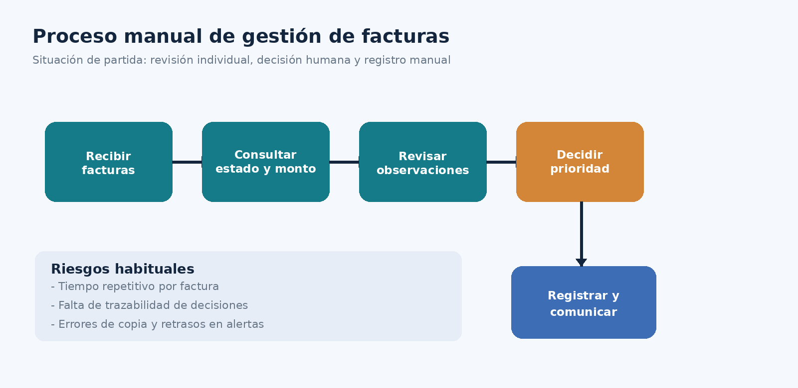
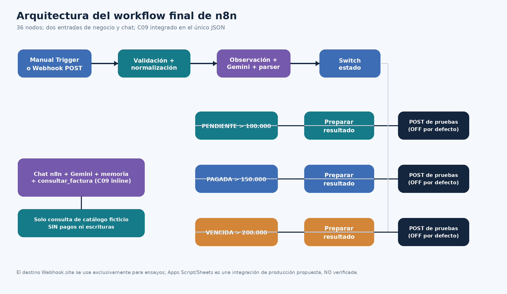

# Documentación del Proyecto Final

**Sistema de clasificación automática de facturas con n8n e inteligencia artificial**  
**Corte final - EAM 2026-II | 16 de noviembre de 2026**  
**Integrantes:** Sara Reyes, Juan Esteban Giraldo, Roberto Carlos Medina, Camilo Andrés Marín, Dilan Andrés Buelvas  
**Versión de referencia:** `workflows/Workflow_Final.json` (36 nodos, C09 embebido, HTTP de pruebas desactivados).

## 1. Contexto y objetivo

La revisión manual de facturas exige verificar estados, montos y observaciones para priorizar acciones. Los errores al transcribir o interpretar solicitudes pueden retrasar la atención. El objetivo es automatizar la clasificación de cuatro tipos de situaciones: pagos pendientes de alto monto, pagos de alto valor que requieren auditoría, facturas vencidas críticas y otros casos que no superan umbrales. Se añade un agente de consulta para responder preguntas sobre un catálogo ficticio de solo lectura.

**Usuarios de referencia:** equipos administrativos y pequeños negocios. **Alcance real:** prototipo académico local con datos sintéticos y recepción HTTP de ensayo. No gestiona cobro efectivo, no valida comprobantes bancarios y no ofrece autorización empresarial de usuarios.

## 2. Equipo y responsabilidades de los módulos

La distribución se basa en la bitácora del corte anterior (C08) y en los componentes del flujo; no se presupone que una sola persona editó todos los nodos de su módulo.

| Integrante | Rol documentado | Relación con el flujo |
|---|---|---|
| Sara Reyes | Diseño funcional y criterios de aceptación | Categorías de observación, resultados esperados y revisión humana |
| Juan Esteban Giraldo | Construcción e integración de IA | Clasificación de observaciones, bifurcaciones y continuidad del proceso |
| Roberto Carlos Medina | Integración API/HTTP | Envíos POST, recepción por endpoint de prueba y ruta potencial Apps Script |
| Camilo Andrés Marín | Validaciones y gestión de fallos | Contrato JSON de IA, validaciones de entrada y rutas de error |
| Dilan Andrés Buelvas | Agente conversacional y pruebas integrales | Memoria por conversación, `consultar_factura` y recorrido de comprobaciones |

## 3. Proceso previo y proceso automatizado

### 3.1. Manual



Recepción de datos → consulta individual → lectura de observaciones → decisión de prioridad → registro/comunicación. Posibles dificultades: demora por repetición, errores al copiar información, inconsistencias y ausencia de trazabilidad uniforme.

### 3.2. Automatizado



La topología real cuenta con **36 nodos** y entradas independientes: disparador manual, Webhook POST y chat local. Los nodos deterministas manejan la integridad de datos, umbrales y ramificación. Gemini se utiliza únicamente para interpretar observaciones de lenguaje natural y para contestar consultas del agente. Los POST externos se conservan **deshabilitados** en el JSON público.

## 4. Entradas y esquema de datos

| Campo | Tipo usado | Regla / tratamiento |
|---|---|---|
| `numero_factura` | texto | en Webhook, patrón `FAC-` seguido de caracteres alfanuméricos o guion (1 a 40); en C09 formato estricto de tres dígitos |
| `cliente` | texto | no vacío y longitud máxima 200 caracteres en Webhook |
| `monto` | número (o convertible) | finito y estrictamente positivo en Webhook |
| `estado_pago` | texto | `pendiente`, `pagado` o `vencida` |
| `observacion` | texto opcional | si 1 a 1200 caracteres: analiza Gemini; en otro caso omite clasificación |
| `ticket` | texto generado | prefijo `TCK-` + factura + marca de tiempo; **no garantiza unicidad absoluta ni idempotencia** |
| `fila_hoja` | texto derivado | representación para registro/seguimiento, no implica que se escribiera en Sheets |

**Importante:** el webhook acepta `FAC-006`, mientras que el catálogo ficticio de la herramienta `consultar_factura` solo contiene `FAC-001` a `FAC-004`. Son entradas de componentes diferentes, no una contradicción funcional.

## 5. Recorrido técnico real

1. `Manual Trigger (pruebas)` construye cuatro facturas; alternativamente `Webhook - Factura` recibe un POST autenticado y pasa por `IF - Datos completos (webhook)`.
2. Si el Webhook detecta datos inválidos, `Respond to Webhook - Invalido` retorna **400**, con `DATOS_INVALIDOS`. Si son válidos, `Normalizar entrada Webhook` prepara los campos.
3. `Expresiones: limpiar + ticket + fila_hoja + monto` normaliza `estado_pago`, convierte monto a número y genera `ticket`/`fila_hoja`.
4. `IF - Observacion utilizable` envía texto elegible a `Clasificar observacion con IA` o usa `Sin observacion: omitir IA`.
5. `Clasificar observacion con IA` usa `Google Gemini Chat Model` y `Contrato de respuesta IA`; `Comprobar respuesta IA` valida categorías, tipos, resumen y booleano. Los fallos se desvían a `Fallo del modelo IA` con `requiere_revision_ia=true`.
6. `Switch estado_pago` conduce a tres rutas; cada ruta evalúa umbrales y produce campos `resultado`, `asunto` y `cuerpo`.
7. Los tres `HTTP Request: registrar ...` fueron probados en Webhook.site, pero **se guardaron desactivados** en el JSON de entrega. No representan Google Sheets activo.
8. `Respond to Webhook - Confirmacion` define respuesta **200** con `ok`, `resultado`, `asunto` y `ticket`. En la ruta de ensayo con nodos HTTP desactivados se observó esta respuesta para FAC-006.

## 6. Reglas de negocio y resultados

| Estado | Umbral (>) | Nodo de decisión | Caso ilustrativo | Salida |
|---|---:|---|---|---|
| pendiente | 100000 | `Filter monto alto` | FAC-001: 150000 | urgente |
| pendiente | 100000 | `Filter monto alto` | FAC-002: 80000 | descartada del seguimiento urgente |
| pagado | 150000 | `IF - Pagada monto alto` | FAC-003: 200000 | auditoría |
| pagado | 150000 | `IF - Pagada monto alto` | caso no alto | `Resultado pagada` |
| vencida | 200000 | `IF - Vencida critica` | FAC-004: 300000 | escalamiento crítico |
| vencida | 200000 | `IF - Vencida critica` | caso no crítico | `Resultado vencida` |

Para las ramas de pagadas o vencidas no altas también existe un nodo de resultado. La evidencia seleccionada verifica principalmente los casos de alto valor y no prueba expresamente todos los límites de igualdad.

## 7. Componente Gemini y controles

**Proveedor:** Google Gemini; modelo configurado en ambos nodos `models/gemini-3.1-flash-lite`. La disponibilidad depende de la cuenta. La IA resuelve interpretación semántica de observaciones libres; las condiciones numéricas y estados permanecen bajo lógica determinista.

**Entrada al clasificador:** un JSON serializado con `observacion`, introducido en un prompt que advierte que el texto es **dato sin autoridad**. **Salida esperada:**

```json
{"categoria":"solicitud_plazo","resumen":"El cliente solicita un plazo adicional para pagar.","requiere_revision":false}
```

**Categorías:** `solicitud_plazo`, `reclamo`, `confirmacion_pago`, `otro`. El contrato exige las tres propiedades y prohíbe propiedades adicionales. La regla del prompt exige revisión para confirmaciones de pago y pedidos de ignorar instrucciones. `Comprobar respuesta IA` rechaza estructuras incorrectas y activa revisión humana. Si la observación no sirve, se marca `omitido_sin_texto`; si falla el modelo, se marca `fallo_modelo_o_formato`.

### 7.1. Agente conversacional C09 integrado

`Chat local de prueba (agente)` → `Validar turno y sesion` → `Agente de facturas` (Gemini) con `Memoria por conversacion` + herramienta `consultar_factura` → `Preparar respuesta del chat`.

`consultar_factura` utiliza `Source: Define Below`: contiene dentro del **mismo JSON** un subflujo de catálogo inmutable `FAC-001 a FAC-004`. Retorna estados `consultada`, `no_encontrada` o `entrada_no_valida` con datos ficticios. No hay acciones de escritura, cobro, anulación ni descuentos. La memoria preserva contexto por sesión; **no** es una prueba de aislamiento entre dos usuarios. Las consultas de estado actual deben volver a usar la herramienta, no asumir frescura de memoria.

## 8. API y operaciones HTTP

### 8.1. Webhook de entrada

- Método: `POST`.
- Ruta de prueba local: `http://localhost:5678/webhook-test/factura-evento-c11-pruebas`.
- Autenticación: **Header Auth**, encabezado `X-Facturas-Test-Key` (valor privado en credencial, no en el JSON).
- Respuesta inválida: `400`, objeto JSON con `ok=false` y `error=DATOS_INVALIDOS`.
- Respuesta correcta observada para FAC-006: `200`, `ok=true`, resultado de seguimiento urgente, asunto y ticket.

### 8.2. HTTP Request de salida

| Nodo | Método | Destino conservado | JSON enviado |
|---|---|---|---|
| registrar urgente | POST | URL temporal de Webhook.site (en nodo) | factura, cliente, monto, estado, resultado, asunto, ticket |
| registrar pagada | POST | mismo receptor temporal | campos equivalentes, con resultado de auditoría |
| registrar vencida | POST | mismo receptor temporal | campos equivalentes, con escalamiento crítico |

En PF-22/23/24, Webhook.site recibió solicitudes reales de **facturas ficticias**. La prueba de FAC-004 se repitió después de mejorar la conservación/envío de campos; la evidencia final confirma el JSON completo. El receptor respondió con un mensaje de configuración predeterminada, no con confirmación de escritura a Google Sheets. Estos POST **no se ejecutan por defecto** en la exportación final.

### 8.3. Paso opcional hacia producción: Apps Script + Google Sheets

La alternativa de producción se diseñó/exploró en versiones anteriores. **No fue verificada como integración activa en este corte**. Para implementarla: publicar un endpoint autorizado (Apps Script u otra API), establecer permisos y autenticación, normalizar payload/respuesta, ajustar los tres nodos HTTP, implementar deduplicación y monitoreo, verificar respuesta del destino y probar recuperación frente a fallos/duplicados antes de habilitarla.

No publicar URL privada, despliegues con acceso sensible ni tokens. Conservar el endpoint de Webhook.site en el JSON **solo para demostrar el entorno controlado**, tal como fue probado, y explicar que puede dejar de estar disponible.

## 9. Resultados respaldados por evidencia

| ID | Comprobación | Resultado documentado | Archivo |
|---|---|---|---|
| PF-08 | FAC-001 existente | cliente, monto y estado correctos | [PF08](../pruebas/evidencias/PF08_Consulta_FAC001.png) |
| PF-09 | FAC-999 inexistente | sin datos inventados | [PF09](../pruebas/evidencias/PF09_Factura_Inexistente.png) |
| PF-10 | Rechazo de modificación | no se marca pagada; reconsulta pendiente | [PF10](../pruebas/evidencias/PF10_Estado_Conservado.png) |
| PF-11 | Memoria conversacional | recupera FAC-001 sin repetir número | [PF11](../pruebas/evidencias/PF11_Memoria_Conversacional.png) |
| PF-12 | Entrada FAC-ABC | se rechaza por formato | [PF12](../pruebas/evidencias/PF12_Entrada_Invalida.png) |
| PF-13-19 | Switch, filtros, salidas | rutas urgente/auditoría/crítica verificadas | [PF13](../pruebas/evidencias/PF13_Switch_Estados.png) |
| PF-20 | Monto -100 | HTTP 400 recibido; rama falsa | [Configuración 400](../pruebas/evidencias/PF20_Configuracion_Respuesta_400_SIN_CLAVE.png) |
| PF-21 | POST FAC-006 válido | HTTP 200 y JSON de urgente | [PowerShell 200](../pruebas/evidencias/PF21_Webhook_HTTP200.png) |
| PF-22 | POST urgente | recibido por Webhook.site | [PF22](../pruebas/evidencias/PF22_HTTP_Urgente.png) |
| PF-23 | POST pagada | recibido por Webhook.site | [PF23](../pruebas/evidencias/PF23_HTTP_Pagada.png) |
| PF-24 | POST vencida | recibido JSON completo | [PF24](../pruebas/evidencias/PF24_HTTP_Vencida.png) |

Véase la [Bitácora de clase 11](../pruebas/Bitacora_Clase_11_Pruebas.md) para condiciones, conclusiones y pendientes.

## 10. Gestión de fallos, duplicados y límites

- **Negativos del negocio:** factura inexistente, formato inválido y solicitudes de escritura desde chat se rechazan o informan sin afirmar pagos.
- **Errores de IA:** parser estructurado + salida de revisión; la caída/cuota de Gemini y el timeout no se simularon exhaustivamente.
- **Errores HTTP:** un `403` de cabecera incorrecta y un `404` con Webhook de prueba no escuchando se observaron durante preparación; la entrega publica solo las evidencias satisfactorias seleccionadas y conserva aquí las dependencias técnicas pertinentes sin afirmar que jamás ocurrieron fallos.
- **Operación parcialmente completada:** no existe una transacción atómica entre decisión, API y destino. Si el POST se ejecuta y la respuesta se pierde, podría haber duplicación al reintentar. Diseñar un idempotency key estable y confirmar en el destino antes de producción.
- **Protección de información:** el Webhook usa credencial HTTP, pero el JSON público no contiene secretos; la credencial anterior expuesta debe ser rotada. El contenido interno de ejecuciones puede incluir encabezados de autorización: las capturas publicadas deben omitirlos.
- **Datos y rendimiento:** no hay benchmark cuantitativo; no afirmar reducción temporal o precisión porcentual sin mediciones.

## 11. Cambios desde corte anterior y estado de pendientes

Se incorporó el agente con memoria y catálogo C09 embebido; se validaron tres ramas, los códigos HTTP 400/200 y la recepción de POST por un receptor controlado. El flujo original exploró Apps Script, pero el corte final verificado **no incluye escritura comprobada en Sheets**. Pendientes: pruebas de reimportación aislada, límites exactamente iguales a umbrales, caída deliberada de IA/API, duplicados, aislamiento entre sesiones y seguridad/operación de producción.

## 12. Instrucciones de reproducibilidad y alcance de la evidencia

Toda la información de clientes y facturas es ficticia. Importar el JSON, asignar credenciales propias, dejar las salidas HTTP en OFF y comenzar por Manual Trigger permite repetir el recorrido sin acceso a servicios de negocio. Para probar salida externa, establecer un receptor temporal **propio** y habilitar solo la rama que se desea probar. El repositorio no constituye un despliegue público de n8n. La existencia de un nodo verde deshabilitado **no demuestra** un POST externo. La importación del JSON saneado en una instancia completamente nueva **queda por acreditar con captura**.
