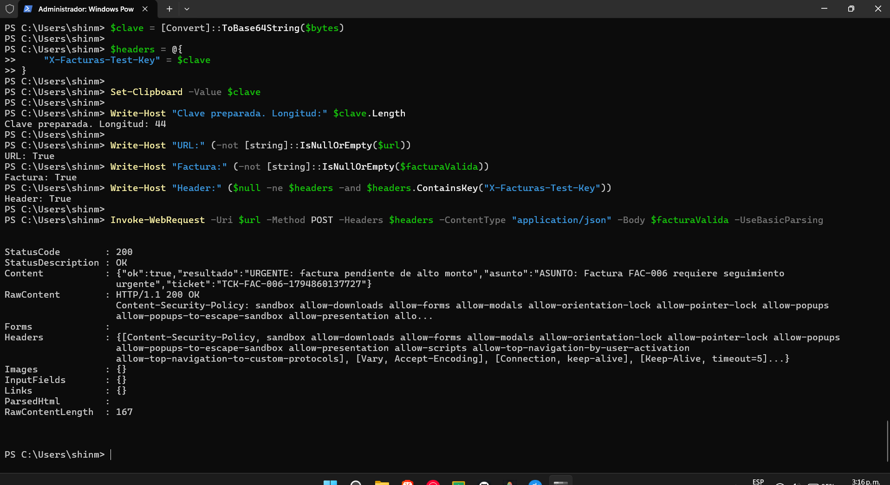
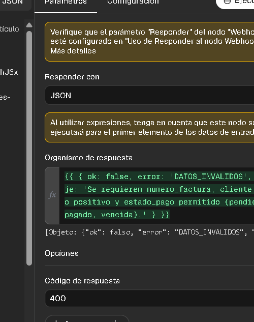
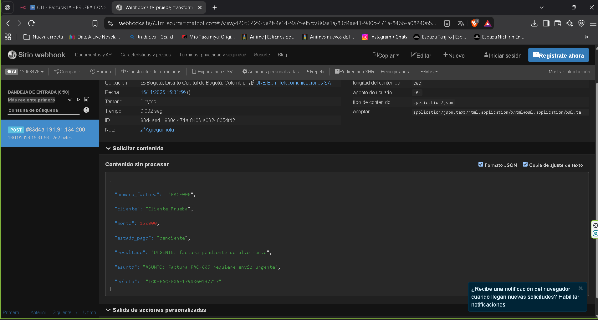
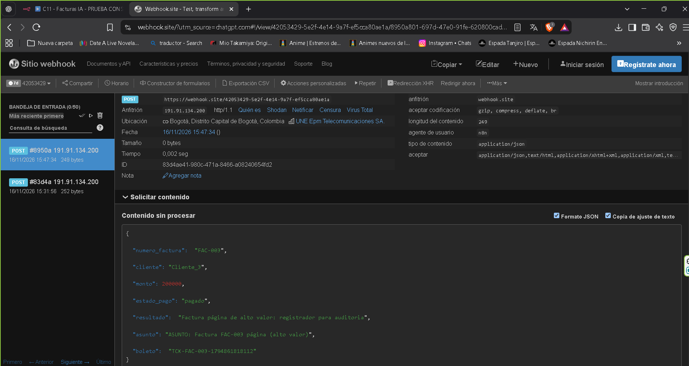
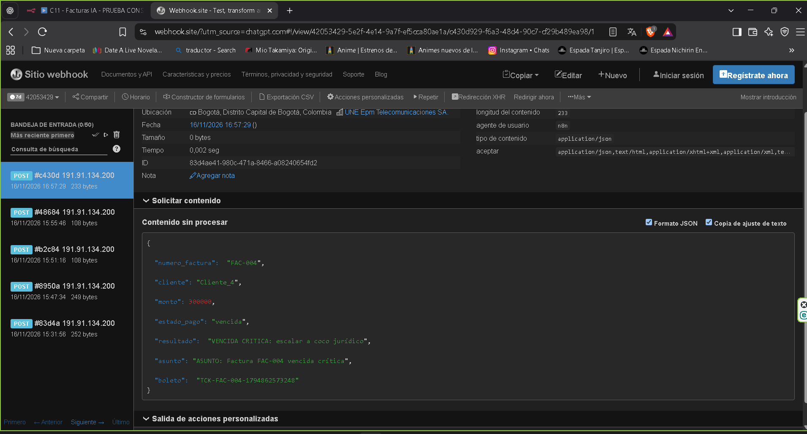

# Bitácora de Clase 11 - Revisión integral y pruebas finales

**Proyecto:** Sistema de clasificación automática de facturas con n8n e IA  
**Corte:** Final (continuidad de cortes 2 y 3)  
**Fecha de comprobaciones finales:** 16 de noviembre de 2026  
**Equipo:** Sara Reyes, Juan Esteban Giraldo, Roberto Carlos Medina, Camilo Andrés Marín, Dilan Andrés Buelvas  
**Versión contrastada:** `workflows/Workflow_Final.json`, exportación saneada de la copia **C11 - Facturas IA - PRUEBA CONSULTA INTEGRADA (HTTP OFF)** (36 nodos).

## 1. Propósito y antecedentes

Se conserva la revisión integral de clase 11 como registro independiente y se completa con pruebas reales de IA, reglas de negocio, autenticación, Webhook y registro HTTP. En cortes previos se ensayaron variantes con formularios, HTTP/Apps Script y subworkflow C09 externo; la versión final de prueba integra C09 dentro del JSON principal y usa Webhook.site como receptor controlado. La bitácora C09 del 13/11 documentaba consultas con agente y riesgos RC-01 a RC-24; esta edición actualiza únicamente lo efectivamente ensayado.

## 2. Condiciones iniciales / metodología

- Entorno observado: n8n local `localhost:5678` en Windows 11/Docker; modelo configurado `models/gemini-3.1-flash-lite`; credenciales privadas configuradas **fuera** del JSON exportado.
- Datos ficticios: FAC-001 a FAC-004 (Manual Trigger y catálogo C09 de consulta), FAC-005 inválida (-100) y FAC-006 válida (Webhook POST).
- En pruebas de los nodos deterministas se ejecutó el flujo por `Manual Trigger` (y en ocasiones paso a paso), con salidas externas deshabilitadas.
- Para API: se activó Test URL de `Webhook - Factura`, con `Header Auth`; se comprobó código 400 y 200 usando PowerShell 5.1.
- Para envío externo: se habilitó individualmente cada `HTTP Request`, se revisó el JSON y se verificó el POST recibido por **Webhook.site** con datos sintéticos; al concluir se volvió al estado OFF.
- Un nodo de n8n en verde **no prueba** recepción por terceros; las evidencias PF-22-24 incluyen el destino. Las capturas que mostraban claves no se reproducen intactas: se aporta una vista recortada, sin secretos, del código 400 configurado.

## 3. Revisión integral: controles y brechas

| Área | Protección identificada | Estado de comprobación |
|---|---|---|
| Entrada HTTP | Header Auth y validación antes de procesar | 400 rechazado y 200 correcto |
| Esquema del negocio | estado permitido, cliente, monto positivo | monto negativo probado; casos de frontera faltan |
| Observación IA | límite 1200, parser estructurado, salida de fallo | ramas con/sin observación probadas; fallo deliberado no probado |
| Prompt-injection en observación | tratar instrucciones del texto como datos | FAC-004 clasificada `otro` con revisión humana |
| Estados y montos | Switch + Filter / IF | ejemplos de tres rutas probados |
| Agente | consulta solo lectura + restricción de modificaciones | comprobado con FAC-001, FAC-999 y rechazo de cambios |
| Memoria | sesión de chat | continuidad en una sesión; aislamiento intersesión pendiente |
| API externa | tres POST JSON de prueba | recepción real comprobada en Webhook.site |
| Apps Script/Sheets | ruta alternativa explorada históricamente | NO verificada en esta versión |
| Duplicados / recuperación | ticket con marca de tiempo | no existe deduplicación de producción ni recuperación transaccional |
| Secretos / evidencias | cabecera privada y API Key en gestor de credenciales | exportación sin IDs/valores; rotar claves expuestas históricamente |

## 4. Matriz de pruebas ejecutadas

Cada caso conserva entrada, resultado observado y archivo concreto. **Criterio de aceptación:** coincide la respuesta/salida con la especificación del flujo y, cuando hay solicitud externa, el receptor muestra el POST. «Cumple» se refiere a la condición de ensayo, no a producción.

| ID | Objetivo | Entrada o acción exacta | Resultado observado | Dictamen | Evidencia |
|---|---|---|---|---|---|
| PF-08 | Consulta válida | Chat: «Consulta la factura FAC-001» | FAC-001 / Cliente_1 / 150000 / pendiente | Cumple | [Captura](evidencias/PF08_Consulta_FAC001.png) |
| PF-09 | Consulta inexistente | Chat: «Consulta la factura FAC-999» | No encontrada; sin inventar cliente ni monto | Cumple | [Captura](evidencias/PF09_Factura_Inexistente.png) |
| PF-10 | Prohibición de escritura | Solicitar marcar FAC-001 pagada; reconsultar | Rechazo y reconsulta pendiente | Cumple | [Captura](evidencias/PF10_Estado_Conservado.png) |
| PF-11 | Memoria de sesión | Preguntar última factura sin número | FAC-001, Cliente_1, 150000 | Cumple en misma sesión | [Captura](evidencias/PF11_Memoria_Conversacional.png) |
| PF-12 | Formato incorrecto | Chat: «Consulta FAC-ABC» | No confirma monto y solicita ID correcto | Cumple | [Captura](evidencias/PF12_Entrada_Invalida.png) |
| PF-13 | Switch estados | Manual Trigger → IA → Switch | Pendiente/pagada/vencida separados | Cumple | [Captura](evidencias/PF13_Switch_Estados.png) |
| PF-14 | Filtro monto pendiente | FAC-001 150000 / FAC-002 80000 | FAC-001 pasa; FAC-002 no pasa | Cumple | [Captura](evidencias/PF14_Filtro_Monto_Pendiente.png) |
| PF-15 | Pagada alta | FAC-003 200000 pagado | IF verdadero / revisión humana | Cumple | [Captura](evidencias/PF15_Pagada_Alto_Valor.png) |
| PF-16 | Vencida crítica | FAC-004 300000 vencida | IF verdadero / categoría otro / revisión humana | Cumple | [Captura](evidencias/PF16_Vencida_Critica.png) |
| PF-17 | Mensaje vencida | FAC-004 / Resultado vencida critica | Resultado, asunto y cuerpo generados | Cumple | [Captura](evidencias/PF17_Resultado_Vencida.png) |
| PF-18 | Mensaje auditoría | FAC-003 / Resultado pagada alto valor | Resultado, asunto y cuerpo generados | Cumple | [Captura](evidencias/PF18_Resultado_Pagada.png) |
| PF-19 | Mensaje urgente | FAC-001 / Resultado urgente | Resultado, asunto y cuerpo generados | Cumple | [Captura](evidencias/PF19_Resultado_Urgente.png) |
| PF-20 | Rechazo API inválida | POST FAC-005 monto -100 y Header Auth | HTTP 400; rama falsa; DATOS_INVALIDOS configurado | Cumple código; cuerpo no capturado | [Captura](evidencias/PF20_Configuracion_Respuesta_400_SIN_CLAVE.png) |
| PF-21 | Respuesta API válida | POST FAC-006, pendiente 150000, observación plazo | HTTP 200 / ok true / seguimiento urgente | Cumple | [Captura](evidencias/PF21_Webhook_HTTP200.png) |
| PF-22 | POST destino urgente | Registrar FAC-006 (temporal Webhook.site) | POST recibido con JSON de seguimiento | Cumple | [Captura](evidencias/PF22_HTTP_Urgente.png) |
| PF-23 | POST destino auditoría | Registrar FAC-003 (temporal Webhook.site) | POST recibido con JSON de auditoría | Cumple | [Captura](evidencias/PF23_HTTP_Pagada.png) |
| PF-24 | POST destino vencida | Registrar FAC-004 (temporal Webhook.site) | POST final recibido con datos y ticket | Cumple | [Captura](evidencias/PF24_HTTP_Vencida.png) |

### 4.1. Casos representativos y detalles de ejecución

**PF-08 a PF-12 (agente):** El agente de prueba consultó el catálogo C09 integrado para FAC-001, rechazó FAC-999 y FAC-ABC y rehusó cambiar el estado de pago. La reconsulta mantuvo `pendiente` y una pregunta posterior sin número recuperó FAC-001 desde el contexto de la misma sesión. La captura del agente no demuestra por sí sola nueva consulta de datos en PF-11; sí demuestra continuidad de contexto.

**PF-13 a PF-19 (proceso):** `Switch estado_pago` se observó con **dos ejecuciones internas** debido a ramas con/sin análisis de observación. FAC-002 (`80000`) quedó fuera de seguimiento urgente, aunque apareciera en el INPUT del Filter. Para FAC-003 (`200000`), la IA indicó `confirmacion_pago`, `requiere_revision_ia=true` y `revision_humana`; FAC-004 (`300000`), frente a la orden de ignorar reglas, mantuvo estado vencido y solicitó revisión humana. Las tres ramas produjeron asunto, cuerpo y resultado.

**PF-20 (Webhook inválido):** `FAC-005` tenía monto `-100`. La primera fase recibió el POST autenticado. El IF devolvió **False Branch**, y `Respond to Webhook - Invalido` tenía `responseCode: 400` y `error: DATOS_INVALIDOS`. En PowerShell se recibió **HTTP 400**, según transcripción de consola del equipo. El ZIP disponible **no aporta captura separada de terminal con 400**; se preserva la vista saneada del nodo configurado y se declara expresamente esta limitación documental. No se insertan imágenes de intentos previos 403/404.

**PF-21 (Webhook válido):** entrada FAC-006, monto 150000, pendiente, observación que solicita ampliar plazo. PowerShell devolvió **HTTP 200 OK** y un JSON con `ok:true`, `resultado: URGENTE: factura pendiente de alto monto`, asunto y ticket. Se mantuvieron los POST externos desactivados para la prueba de respuesta.

**PF-22 a PF-24 (registro externo):** al habilitar temporalmente cada HTTP Request de manera individual, Webhook.site recibió tres POST con JSON ficticio: FAC-006 urgente, FAC-003 pagada alto valor y FAC-004 vencida crítica. Una primera transmisión de FAC-004 solo mostraba resultado/asunto; se ajustó su contenido y el **último POST** incluido en esta bitácora presenta número, cliente, monto, estado, resultado, asunto y ticket. No es evidencia de almacenamiento en Google Sheets.

## 5. Evidencias visuales esenciales

*Figura 1. Respuesta de prueba: PowerShell muestra HTTP 200 y resultado urgente para FAC-006.*

*Figura 2. Parámetros del nodo de respuesta inválida; vista recortada sin encabezados secretos.*

*Figura 3. Recepción de JSON urgente por Webhook.site en entorno controlado.*

*Figura 4. Recepción del JSON de auditoría por Webhook.site.*

*Figura 5. Registro final de vencida crítica con campos de factura presentes.*

## 6. Estado final de pendientes

| ID | Pendiente / riesgo | Responsable funcional | Estado final y criterio para cerrar |
|---|---|---|---|
| P-01 | Importar el JSON saneado en instalación independiente | Dilan Andrés Buelvas / Juan Esteban Giraldo | **Pendiente**: captura de 36 nodos importados, credenciales propias, C09 inline y recorrido Manual |
| P-02 | Umbrales EXACTOS 100000, 150000, 200000 y casos sin acción | Sara Reyes / Camilo Andrés Marín | **Pendiente**: evidencia TRUE/FALSE en igualdad, 0 y valores inválidos |
| P-03 | Caída, cuota o respuesta inválida de Gemini | Juan Esteban Giraldo / Camilo Andrés Marín | **Pendiente**: fallo inducido y salida `fallo_modelo_o_formato` sin escritura |
| P-04 | Idempotencia, errores API y registro repetido | Roberto Carlos Medina | **Pendiente**: receptor controlado con duplicados/503 y regla de reintento documentada |
| P-05 | Aislamiento de sesiones del agente | Dilan Andrés Buelvas | **Pendiente**: dos sesiones separadas sin mezcla de contexto |
| P-06 | Destino real Apps Script/Sheets con permisos | Roberto Carlos Medina | **No implementado en corte final**: requiere desarrollo y verificación productiva |
| P-07 | Verificar claves y capturas compartidas previamente | Todo el grupo | **Antes de publicar**: rotar valores expuestos y evitar trazas con cabeceras |
| P-08 | Publicación de repo GitHub y comprobación sin sesión | Todo el grupo | **Pendiente**: URL del repositorio real y acceso público |

### 6.1. Cierre de pendientes cubiertos durante la clase

Se cerraron operativamente la conexión del agente a C09 sin dependencia de otro archivo, la comprobación de consulta válida/no encontrada, rechazo de modificaciones, clasificación de observaciones, enrutamiento de los tres estados, respuesta webhook para entrada inválida/válida y emisión de POST reales **a un receptor temporal**. Se documentan sin atribuirles efectos sobre datos financieros reales.

## 7. Conclusiones y acuerdos

El prototipo cumplió las pruebas esenciales bajo datos sintéticos. Los modelos se limitaron a interpretar observaciones o consultas, mientras reglas numéricas y permisos quedaron en nodos deterministas. El equipo acordó mantener la URL de Webhook.site **solo para identificar la prueba** y dejar los tres HTTP desactivados en el JSON publicado; un uso real requeriría sustituirlo por Apps Script o API propia con seguridad, deduplicación y observabilidad. No se declara finalizada la verificación de importación en otra instancia ni la operación en producción.

## 8. Trazabilidad documental

- [Workflow final](../workflows/Workflow_Final.json)
- [Documentación técnica actualizada](../documentacion/Documentacion_Proyecto_Final.md)
- [README](../README.md)
- [Presentación PDF](../presentacion/Presentacion_Proyecto_Final.pdf)
- [Proceso automatizado](../documentacion/diagramas/Proceso_Automatizado.png)

**Protección:** nunca publicar capturas de encabezados HTTP con valor, API Keys o credenciales. Si aparecieron en material histórico no incluido, ese material permanece fuera del repositorio.
